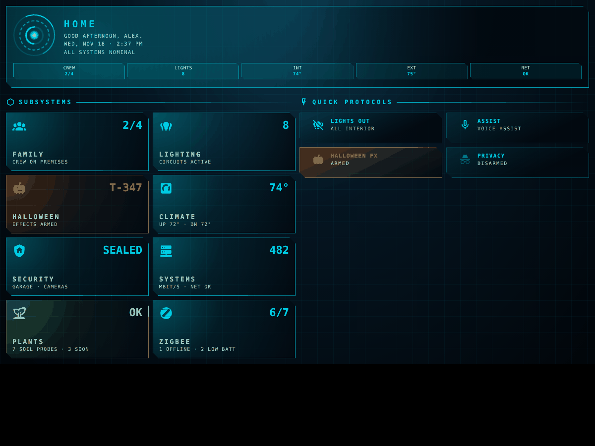

# JV HUD Cards

A collection of holographic heads-up-display cards for Home Assistant dashboards: angled panels, a spinning reactor core, HUD chips, mono-spaced telemetry. Same idea as Mushroom: one install that gives you a family of matching cards, and every option can be set in the visual editor.



Built for **sections** views. There are no dependencies, so you don't need button-card, card-mod or Lit, and there's no build step at runtime.

| Card | Use it for |
|---|---|
| `jv-reactor-card` | Hero panel: animated reactor, greeting/clock, status lines, alert roll-up, HUD chip strip |
| `jv-nav-card` | Subsystem tile with a headline stat that navigates to a view |
| `jv-tile-card` | Toggle, action button or status tile |
| `jv-readout-card` | Large sensor or status readout |
| `jv-section-card` | Section heading with a scan line |
| `jv-chips-card` | Standalone row of HUD chips |
| `jv-person-card` | Person: photo, presence, location, battery, motion, time in state |
| `jv-thermostat-card` | Ring-gauge thermostat with HVAC action and −/+ setpoint control |
| `jv-meter-card` | Threshold meter (soil moisture, battery, tank…) or a ranked list of them |
| `jv-timeline-card` | History: state bands, attribute bands with duty cycle, sparklines, multi-series lines |
| `jv-zigbee-card` | Zigbee mesh health from the device registry: summary, maintenance orders, offline nodes, battery fleet, roster |

---

## Install

### Marketplace (Home Assistant 2026.11+) or HACS

1. **Settings → Marketplace** (or **HACS** on 2026.10 and older) → menu → **Add from link / Custom repositories**.
2. Paste this repository's URL and choose the **Dashboard** (plugin) category.
3. Install **JV HUD Cards**. In storage-mode dashboards the resource is registered for you.
4. Hard-refresh the browser (Ctrl/Cmd + Shift + R), or use **Settings → Reset frontend cache** in the Companion app.

### Manual

Copy `dist/jv-hud-cards.js` to `/config/www/jv-hud-cards/`, then add a resource under **Settings → Dashboards → ⋮ → Resources**: URL `/local/jv-hud-cards/jv-hud-cards.js?v=1.0.0`, type **JavaScript module**. Change the `?v=` value whenever you update the file, because `/local/` is cached for 31 days.

> If you previously registered an inline `jv-timeline-card` resource, delete it. This package includes that card, and only one definition can register.

---

## Visual editor

Every card opens in a visual editor in the dashboard's card editor, and the code editor is never required. Configs you've already written in YAML open in it unchanged.

- **Lists** (chips, status lines, alerts, timeline rows and lines, legend entries, watering-queue entities) can be added, removed, reordered and collapsed.
- **Values**: a **Source** picker on any dynamic field (stat, subtitle, chip value, label, status line): Text, Entity state or attribute, Count of entities, Average/min/max/sum, Countdown to a date, Zigbee statistic, If … then … else, or Template.
- **Colours and icons** can be Fixed, follow an entity's state (state → colour/icon, plus "any other state"), switch when conditions match, or come from a template.
- **Conditions** are built as entity + attribute + is / is not / above / below / between, or a template.
- **Severity** (warning and alert colouring) is set by thresholds and state lists, a fixed level, or a template.
- **State labels** are rename rows of state → text.

Only the view background (the grid pattern behind a view) is set outside the card editor. Edit it in the view's own settings, or in YAML.

---

## Look and feel

Every card reads these CSS variables, so you can set them once in a theme, or per card with `card_mod` if you use it:

| Theme variable | Default | Meaning |
|---|---|---|
| `jv-accent-rgb` | `0,229,255` | Default accent as an `r,g,b` triplet |
| `jv-glow-strength` | `0` | `0` = flat (no shadows/glow), `1` = neon glow |
| `jv-corner` | `12px` | Size of the cut corners |
| `jv-surface-rgb` | `2,9,16` | Panel base colour |
| `jv-text-color` / `jv-bright-color` | `#d6f9ff` / `#effdff` | Body and highlight text |
| `jv-font-family` | `'SF Mono', ui-monospace, Menlo, Consolas, monospace` | Typeface |
| `jv-readout-size` | `22px` | Readout value size |

Glow is **off by default**. Turn it on per card with `glow: true`, or for every card with `jv-glow-strength: 1` in your theme. See `examples/theme.yaml` for a theme and the grid view background.

**Accent** on any card accepts a name (`cyan`, `blue`, `amber`, `orange`, `red`, `green`, `violet`, `magenta`, `white`, `slate`, `grey`), an `r,g,b` triplet, a hex colour, a Jinja template, or a value spec (below). This lets an accent follow state:

```yaml
accent:
  entity: binary_sensor.garage_door
  map: { "on": red, _default: cyan }
```

---

## Dynamic values (value specs)

Any field marked *value* takes one of the following:

| Form | Example | Result |
|---|---|---|
| Literal | `Crew on premises` | as written |
| Jinja template | `"{{ states('sensor.x') }}"` | rendered live by HA (`render_template` subscription) |
| Entity | `{entity: sensor.outdoor_temperature, decimals: 0, unit: "°"}` | `74°` |
| Attribute | `{entity: climate.upstairs, attribute: current_temperature}` | `73.5` |
| Mapped | `{entity: binary_sensor.net, map: {"on": OK, "off": DOWN}}` | `OK` |
| Relative time | `{entity: sensor.last_backup, relative: true}` | `9h ago` / `in 3h` |
| Time in state | `{entity: person.alex, since: true}` | `2h` |
| Count | `{count: [person.a, person.b], state: home, total: true}` | `1/2` |
| Count numeric | `{count: [sensor.m1, sensor.m2], below: 20}` | `1` |
| Aggregate | `{avg: [climate.up, climate.dn], attribute: current_temperature, suffix: "°"}` | `73°` (also `min`, `max`, `sum`) |
| Countdown | `{countdown: "10-31"}` | `T-347` (or `LIVE` on the day) |
| Conditional | `{any: [{entity: door.a, state: "on"}], then: OPEN, else: SEALED}` | also `all:` |
| Zigbee | `{zigbee: online_total}` | `42/45` (`total`, `online`, `offline`, `low_battery`, `attention`, `routers`, `availability`, `status`, `headline`) |

Modifiers on any object form: `prefix`, `suffix`, `zero` (text to show when the value is 0), `fallback` (missing entity), `unit: false` (hide the unit).

**Conditions** (used by `any`/`all`, reactor `alerts`, chip `visible`) take the form `{entity, attribute?, state?, state_not?, above?, below?}`, or a template that renders true or false.

**Severity** (chips, readouts, reactor lines) is one of `ok`, `warn`, `bad` or `info`; a template that renders one of those; or rules: `{bad_above, bad_below, warn_above, warn_below, bad_states, warn_states, ok_states, else}`.

**Chips** are lists of `{label, value | entity (+attribute, decimals, unit, map), icon, severity, hide_zero, visible, tap_action, hold_action}`.

---

## Cards

### jv-reactor-card

```yaml
type: custom:jv-reactor-card
name: Home Base
greeting: true            # "Good afternoon, <your first name>."
clock: true               # "Wed, Nov 18 · 2:19 PM"
size: 84                  # reactor diameter, px
lines:
  - "Soil telemetry · 7 probes"
  - text: { count: [sensor.m1, sensor.m2], below: 20, suffix: " need water", zero: All hydrated }
    severity: { ok_states: [All hydrated], else: bad }
alerts:                   # adds "All systems nominal" or the active messages
  - { entity: binary_sensor.internet, state_not: "on", message: Network down, severity: bad }
  - { entity: binary_sensor.garage_door, state: "on", message: Garage open }
ok_text: All systems nominal
alert_accent: false       # true/omitted = recolour the panel while alerts are active
chips:
  - { label: Crew, value: { count: [person.a, person.b], state: home, total: true } }
  - { label: Ext, entity: sensor.outdoor_temperature, unit: "°" }
  - { label: Net, entity: binary_sensor.internet, map: { "on": OK, "off": DOWN }, severity: { bad_states: ["off"] } }
chips_layout: hud         # hud (equal columns, default) | wrap
```

Other options: `greeting_name`, `max_alerts` (2), `accent`, `tap_action`, `hold_action`.

### jv-nav-card

```yaml
type: custom:jv-nav-card
name: Lighting
icon: mdi:lightbulb-group
navigation_path: /dashboard-hud/lighting
stat: { count: [light.a, switch.b], state: "on" }
sub: Circuits active
```

`stat` and `sub` are values. You can use `tap_action` and `hold_action` instead of `navigation_path`.

### jv-tile-card

```yaml
type: custom:jv-tile-card
entity: light.kitchen
name: Kitchen
icon: mdi:ceiling-light
```

The default tap toggles toggleable domains (light, switch, fan, input_boolean, automation, cover, script, scene, button, lock, valve…) and opens more-info for everything else. Hold opens more-info. The tile shows *Active · 70 %*, *Standby*, *Armed/Disarmed* (automations, input_booleans) or *Offline*.

Options: `name`, `icon` (value), `label` (value), `state` (value override), `state_map`, `show_state`, `active_states`, `accent`, `tap_action`, `hold_action`, `double_tap_action`. Leave out `entity` to get a pure action button:

```yaml
type: custom:jv-tile-card
name: Lights Out
icon: mdi:lightbulb-group-off
label: All interior
tap_action:
  action: perform-action
  perform_action: homeassistant.turn_off
  target: { entity_id: [switch.a, light.b] }
  confirmation: { text: Power down all interior lighting? }
```

### jv-readout-card

```yaml
type: custom:jv-readout-card
entity: binary_sensor.router
name: Router
icon: mdi:router-wireless
state_map: { "on": ONLINE, "off": OFFLINE }
accent: { entity: binary_sensor.router, map: { "on": cyan, _default: red } }
```

Options: `attribute`, `value` (value override), `unit`, `decimals` (1), `relative` (timestamp sensors), `uppercase` (true), `severity`, `label`, `font_size`, `wrap`.

### jv-section-card

```yaml
type: custom:jv-section-card
name: Quick Protocols
icon: mdi:flash-outline
accent: orange
```

### jv-chips-card

```yaml
type: custom:jv-chips-card
layout: wrap        # or hud
background: false
chips:
  - { label: Doorbell, entity: sensor.doorbell_battery, severity: { warn_below: 26 } }
```

### jv-person-card

```yaml
type: custom:jv-person-card
entity: person.sam
battery: sensor.phone_sam_battery_level
charging: binary_sensor.phone_sam_battery_charging
location: sensor.sam_location      # or address: (geocoded sensor) / tracker: (device_tracker with address)
speed: sensor.phone_sam_speed
driving: binary_sensor.phone_sam_driving
```

The accent is cyan at home, amber away and violet in a named zone. Options: `name`, `home_text`, `away_text`, `lost_text`, `state_map`, `speed_unit`, `chips` (extra chips).

### jv-thermostat-card

```yaml
type: custom:jv-thermostat-card
entity: climate.upstairs
min: 60          # gauge range (defaults 60–85 °F / 15–30 °C)
max: 85
controls: true   # −/+ setpoint chips (debounced, honours target_temp_step and min/max)
```

The accent is orange while heating and cyan otherwise.

### jv-meter-card

Single:

```yaml
type: custom:jv-meter-card
preset: moisture          # moisture | battery | generic
entity: sensor.palm_soil_moisture
name: Palm
label: Office
battery: sensor.palm_battery
temperature: sensor.palm_temperature
thresholds: { bad: 20, warn: 30, high: 60 }   # override the preset
```

Ranked list (a "watering queue"):

```yaml
type: custom:jv-meter-card
preset: moisture
entities:
  - { entity: sensor.palm_soil_moisture, name: Palm, label: Office }
  - { entity: sensor.fern_soil_moisture, name: Fern, label: Bathroom }
sort: asc      # asc | desc | none
limit: 10
```

Options: `direction: low|high` (whether a low or a high value is bad), `min`/`max` (0–100), `labels: {bad, warn, high, ok, offline}`, `unit`, `chips`.

### jv-timeline-card

```yaml
type: custom:jv-timeline-card
title: Last 24 hours
hours: 24
legend:
  - { label: Cooling, color: cyan }
  - { label: Heating, color: "255,138,40" }
entities:
  - entity: person.alex                       # state band
  - entity: climate.upstairs                  # attribute band + duty cycle
    attribute: hvac_action
    name: Up HVAC
    colors: { cooling: cyan, heating: "255,138,40", idle: slate }
    labels: { cooling: COOL, heating: HEAT }
    duty: [cooling, heating]
  - { type: line, entity: sensor.power, name: Draw, color: cyan }
  - type: multi
    name: Temps
    height: 110
    unit: "°"
    series:
      - { entity: sensor.up_temp, name: Up, color: cyan, width: 2.2 }
      - { entity: sensor.outside, name: Outside, color: amber, dash: "2 4" }
```

Options: `tick_hours`, `label_width` (66), `accent`. A timeline of only person/device_tracker entities gets a Home/Away/Zone legend automatically.

### jv-zigbee-card

```yaml
type: custom:jv-zigbee-card
mode: maintenance      # summary | maintenance | offline | batteries | roster
integration: zha       # or mqtt (Zigbee2MQTT)
battery_low: 30
battery_critical: 15
lqi_weak: 80
quiet_hours: 48
exclude_areas: [Garage]
```

The card groups entities by device from the entity and device registries, so it needs no configuration. **Maintenance** turns problems into numbered work orders (restore power, reconnect, replace or plan a battery swap, weak link, verify). **Roster** groups devices by area and includes a tap-to-toggle control for each device that has a switch or light.

---

## Migrating from the button-card templates

| button-card template | Card |
|---|---|
| `jv_reactor` | `jv-reactor-card` (`custom_fields.sub` → `lines`/`greeting`/`clock`/`alerts`, `custom_fields.stats` → `chips`) |
| `jv_nav` | `jv-nav-card` (`custom_fields.stat`/`sub` → `stat`/`sub`) |
| `jv_toggle`, `jv_hw`, `jv_ztoggle` | `jv-tile-card` (`jv_hw` → `accent: orange`) |
| `jv_action`, `jv_fx` | `jv-tile-card` without `entity` (`jv_fx` → `accent: violet`) |
| `jv_readout` | `jv-readout-card` |
| `jv_section` | `jv-section-card` |
| `jv_person` | `jv-person-card` (the `variables` keep the same names) |
| `jv_thermo` | `jv-thermostat-card` |
| `jv_plant` | `jv-meter-card` with `preset: moisture` |
| `jv_zlist` + `jv_zigbee` | `jv-zigbee-card` with a `mode` |

## Changelog

- **1.1.0**: full visual editor for every card and option.
- **1.0.0**: first release.

## Development

```sh
npm run build     # concatenates src/*.js → dist/jv-hud-cards.js
```

To release, tag `vX.Y.Z` and publish a GitHub release. The workflow attaches `dist/jv-hud-cards.js` so HACS and the Marketplace can offer the update.

MIT licensed.
